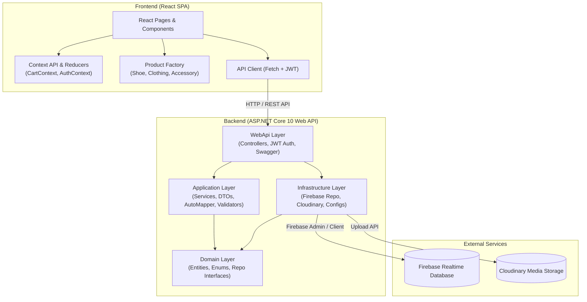

# New Balance Store

> Повнофункціональна e-commerce вебплатформа для перегляду, фільтрації та онлайн-замовлення спортивного взуття й одягу, створена на основі офіційного онлайн-магазину New Balance. Навчальний курсовий проєкт на базі сучасного стеку React, ASP.NET Core Web API та Firebase.

[🌐 Live Frontend](https://balancedevs.onrender.com/) &nbsp;|&nbsp; [📚 GitHub Репозиторій](https://github.com/AlexElNX/NewBalanceStore) &nbsp;|&nbsp; [📑 Документація API (Swagger)](https://newbalancestoreback.onrender.com/swagger) &&nbsp;|&nbsp; [📄 Документація проєкту (DocFX)](https://zemnyux.github.io/NewBalanceStoreBack/index.html)

---

## 📖 About

**New Balance Store** — це  вебзастосунок електронної комерції, спроєктований та реалізований з метою демонстрації принципів побудови масштабованої Clean Architecture, роботи з REST API, автентифікації на базі JWT, хмарних баз даних NoSQL (Firebase Realtime Database) та розробки інтерактивного інтерфейсу користувача на React.

Проєкт відтворює ключові призначені для користувача сценарії сучасного онлайн-магазину брендового взуття: від перегляду та багатокритеріальної фільтрації каталогу до додавання варіацій товару (колір/розмір) у кошик, оформлення замовлення та адміністрування асортименту.

---

## ✨ Features

- 👟 **Каталог товарів із варіаціями**: відображення моделей взуття, одягу та аксесуарів із комбінаціями розмірів, кольорів та обліком кількості на складі (`quantity`/`inStock`).
- 🔍 **Гнучка система пошуку та фільтрації**:
  - Фільтрація за категоріями (`Footwear`, `Clothing`, `Accessories`).
  - Фільтрація за статтю (`Men`, `Women`, `Unisex`).
  - Фільтрація за діапазоном цін (`minPrice`, `maxPrice`).
  - Вибір за кольорами, наявністю та ознакою новинки (`isNew`).
  - Миттєвий текстовий пошук за назвою або описом моделі.
- 🛍️ **Інтерактивна картка та сторінка товару**:
  - Галерея зображень із перемиканням активного кольору.
  - Динамічний вибір доступних розмірів для обраного кольору.
  - Індикатор залишку та ціни (включно зі старими цінами зі знижкою `oldPrice`).
- 🛒 **Кошик покупок (Shopping Cart)**:
  - Бічна шторка (Drawer) та попап «Added to Bag» при додаванні товару.
  - Зміна кількості та видалення позицій.
  - Автоматичний підрахунок вартості замовлення.
  - Синхронізація стану кошика через Context API + Reducer з автозбереженням у `LocalStorage`.
- 📦 **Оформлення замовлення (Checkout Flow)**:
  - Покрокова валідація контактних даних покупця та адреси доставки.
  - Збереження замовлення у базі даних зі статусом `Pending`.
- 🔐 **Автентифікація та авторизація**:
  - Реєстрація та авторизація користувачів за допомогою JWT-токенів.
  - Рольова модель доступу: `Guest`, `Customer`, `Admin`.
  - Захищені маршрути на фронтенді.
- 🛠️ **Панель адміністратора (Admin Dashboard)**:
  - Повний CRUD для товарів (створення, редагування, видалення).
  - Завантаження зображень товарів безпосередньо у хмару Cloudinary через API.
  - Керування та оновлення статусів замовлень (`Pending`, `Processing`, `Shipped`, `Delivered`, `Cancelled`).
- 📱 **Адаптивний UI/UX**: підтримка мобільних пристроїв, планшетів і десктопів (Mobile-First від 320px).

---

## 🎨 Design

Дизайн інтерфейсу базується на зовнішньому вигляді офіційного магазину [**New Balance**](https://www.newbalance.com/):

- **Стилістика**: фірмовий мінімалізм, чітка типографіка без засічок та чистих світлих тонів для контрасту й фокусу на фотографіях виробів.
- **Компоненти UI**:
  - `TopHeader` & `MainHeader`: навігаційне меню, рядок пошуку, посилання на авторизацію та іконка кошика з лічильником товарів.
  - `ProductFilters`: бічна панель фільтрів із підтримкою комбінованого вибору критеріїв.
  - `ProductCard` & `ProductCarousel`: сітка та каруселі популярних товарів.
  - `AddedToBagPopup` & `CartDrawer`: плавні модальні вікна та слайд-овери для взаємодії з кошиком без перезавантаження сторінки.
  - `Footer`: навігаційні розділи, інформація про доставку, повернення та навчальний статус проєкту.

---

## 🏗️ Architecture

Проєкт побудовано за принципами **Clean / Onion Architecture** на бекенді та модульної компонентної архітектури з використанням шаблонів проєктування на фронтенді.



### Шари бекенду:
1. **`NewBalanceStore.Domain`**: ядро системи, що не залежить від жодних зовнішніх бібліотек та баз даних. Містить бізнес-сутності (`Product`, `ProductVariant`, `Cart`, `Order`, `User`), перечислення (`ProductType`, `Gender`, `OrderStatus`, `UserRole`) та контракти репозиторіїв (`IProductRepository`, `IOrderRepository`, `IUserRepository`).
2. **`NewBalanceStore.Application`**: реалізація бізнес-правил та сценаріїв використання. Містить сервіси (`ProductService`, `OrderService`, `AuthService`), об'єкти передачі даних (DTO), профілі мапінгу AutoMapper (`OrderMappingProfile`) та валідатори.
3. **`NewBalanceStore.Infrastructure`**: зв'язок із зовнішніми хмарними сервісами. Містить адаптери до Firebase Realtime Database (`FirebaseProductRepository`, `FirebaseOrderRepository`, `FirebaseUserRepository`) та сервіс роботи з медіафайлами Cloudinary (`PhotoService`).
4. **`NewBalanceStore.WebApi`**: точка входу вебсервера. REST API контролери (`AuthController`, `ProductsController`, `OrdersController`), конфігурація маршрутизації, налаштування JWT Bearer аутентифікації, CORS-політик та Swagger UI.

### Патерни проєктування (Design Patterns):
- **Factory Pattern** (`frontend/src/factory/productFactory.js`): динамічне створення об'єктів товарів відповідних класів (`Shoe`, `Clothing`, `Accessory`) на основі атрибута `type`, що приходить з API.
- **Repository Pattern**: інкапсуляція доступу до даних за інтерфейсами доменного шару.
- **Reducer Pattern**: керування незмінним станом кошика (`cartReducer.js`).
- **Dependency Injection (DI)**: впровадження залежностей через вбудований IoC-контейнер ASP.NET Core.

---

## 🛠️ Tech Stack

| Категорія | Технологія | Опис |
| :--- | :--- | :--- |
| **Frontend Framework** | React 19 | Бібліотека для побудови інтерфейсу користувача |
| **Build Tool** | Vite 8 | Швидкий інструмент збірки та dev-сервер |
| **Routing** | React Router DOM v7/v8 | Клієнтська маршрутизація сторінок |
| **State Management** | React Context + Reducers | Управління глобальним станом кошика та автентифікації |
| **Styles** | CSS / CSS Modules | Модульні та глобальні стилі компонентів |
| **Backend Framework** | ASP.NET Core Web API (.NET 10) | Продуктивний серверний REST API фреймворк |
| **Мова програмування** | C# 13 / JavaScript (ES2023) | Мови бекенду та фронтенду |
| **Database** | Firebase Realtime Database | Хмарна NoSQL база даних реального часу від Google |
| **Media Storage** | Cloudinary | Хмарний сервіс для оптимізації та збереження фотографій товарів |
| **Authentication** | JWT (JSON Web Tokens) | Авторизація за допомогою підписаних токенів та ролей |
| **Mapping** | AutoMapper | Автоматичне перетворення сутностей у DTO |
| **API Documentation** | Swagger / OpenAPI + DocFX | Інтерактивна документація ендпоінтів та статичний сайт документації |
| **Unit & Integration Testing** | NUnit, Vitest, Testing Library | Тестування бекенду та клієнтських компонентів |
| **Containerization** | Docker | Контейнеризація бекенд-застосунку |

---

## 🔐 Authentication

Автентифікація реалізована за стандартом **JSON Web Tokens (JWT)**:

1. **Реєстрація / Вхід**: клієнт надсилає запит на `POST /api/auth/register` або `POST /api/auth/login`.
2. **Видача токена**: бекенд перевіряє облікові дані та повертає підписаний токен із включенням ролі користувача (`ClaimTypes.Role`) та ідентифікатора.
3. **Авторизація запитів**: для захищених операцій токен передається у заголовку:
   ```http
   Authorization: Bearer <jwt_token>
   ```
4. **Рольовий доступ (RBAC)**:
   - **Гість (Guest)**: перегляд каталогу, деталей товару, пошук, фільтрація, локальний кошик.
   - **Покупець (Customer)**: створення замовлень, перегляд власних покупок.
   - **Адміністратор (Admin)**: створення/редагування/видалення товарів (`[Authorize(Roles = "Admin")]`), завантаження фото в Cloudinary, керування статусами замовлень.

---

## 👟 Product Catalog

Каталог є ключовим розділом магазину та підтримує деталізовану модель предметної області:

- **Сутність товару (`Product`)**:
  - `id`: унікальний ідентифікатор.
  - `name`: комерційна назва моделі (наприклад, *New Balance 9060*, *574 Core*).
  - `description`: опис характеристик, матеріалів та технологій.
  - `type`: `Footwear` (Взуття), `Clothing` (Одяг), `Accessories` (Аксесуари).
  - `category`: категорія (наприклад, *Running*, *Lifestyle*, *Basketball*).
  - `gender`: `Men`, `Women`, `Unisex`.
  - `price` та `oldPrice`: актуальна ціна та стара ціна (акція / знижка).
  - `images`: список URL зображень високої якості.
  - `colors`: доступні кольорові гами моделі.
  - `isNew`: позначка нової колекції.
  - `variants`: масив конкретних складських варіацій.
- **Варіація товару (`ProductVariant`)**:
  - `color`: конкретний колір.
  - `size`: розмір (наприклад, US 7, 8, 8.5, 9, 10, M, L).
  - `quantity`: кількість одиниць у наявності на складі.

---

## ⚙️ Configuration

### 1. Backend (`appsettings.json`)
```json
{
  "Firebase": {
    "DatabaseUrl": "https://<your-firebase-database>.europe-west1.firebasedatabase.app/",
    "ProjectId": "<your-project-id>"
  },
  "Jwt": {
    "Secret": "<your-256-bit-secret-key-at-least-32-chars>",
    "Issuer": "NewBalanceStoreBackend",
    "Audience": "NewBalanceStoreFrontend",
    "ExpiryInMinutes": 60
  },
  "CloudinarySettings": {
    "CloudName": "<your-cloudinary-cloud-name>",
    "ApiKey": "<your-cloudinary-api-key>",
    "ApiSecret": "<your-cloudinary-api-secret>"
  }
}
```

### 2. Frontend (`frontend/.env`)
Створіть файл `.env` у каталозі `frontend/`:

---

## 🚀 Getting Started

### Попередні вимоги:
- [.NET 10.0 SDK](https://dotnet.microsoft.com/download)
- [Node.js (v18 або новіший)](https://nodejs.org/) & `npm`
- [Git](https://git-scm.com/)

### Кроки для запуску проєкту локально:

1. **Клонуйте репозиторій**:
   ```bash
   git clone https://github.com/AlexElNX/NewBalanceStore.git
   cd NewBalanceStore
   ```

2. **Запуск Backend**:
   ```bash
   # Відновлення пакетів та запуск API-проєкту
   dotnet restore
   dotnet run --project NewBalanceStore.WebApi
   ```
   API запуститься за адресою `http://localhost:5000` (або `https://localhost:5001`).  
   Swagger UI доступний за адресою: `http://localhost:5000/swagger`.

3. **Запуск Frontend**:
   ```bash
   cd frontend
   npm install
   npm run dev
   ```
   Клієнтський застосунок відкриється за адресою `http://localhost:5173`.

---

## 📦 Build

### Збірка серверної частини (Release):
```bash
dotnet build -c Release
dotnet publish NewBalanceStore.WebApi/NewBalanceStore.WebApi.csproj -c Release -o ./publish
```

### Збірка клієнтської частини (Frontend):
```bash
cd frontend
npm run build
```
Зібрані статичні оптимізовані файли будуть створені в директорії `frontend/dist/`.

### Генерація сайту документації (DocFX):
```bash
docfx docfx.json
```
Згенерована документація зберігається в папці `docs/`.

---

## 🌐 Deployment

- **Backend**: **Render**.
- **Frontend**: **Vercel**.
- **Database & Storage**: Google Firebase Realtime Database та Cloudinary керуються у хмарі та доступні за надійними API-ключами.

---

## 📸 Screenshots

| Головна сторінка | Каталог та фільтри |
|:---:|:---:|
| *(Головний банер, новинки та промо-колекції)* | *(Фільтрація за розміром, статтю та ціною)* |

| Сторінка товару | Кошик та оформлення |
|:---:|:---:|
| *(Вибір кольору, розміру, галерея фото)* | *(Шторка кошика та введення даних доставки)* |

| Swagger REST API | Панель адміністратора |
|:---:|:---:|
| *(Інтерактивна документація ендпоінтів)* | *(Керування товарами та статусами замовлень)* |

---

## 🧪 Testing

Проєкт містить повне покриття ключової бізнес-логіки юніт- та інтеграційними тестами:

### 1. Бекенд-тести
- **Unit Tests (`NewBalanceStore.UnitTests`)**: 51 тест (покриття `ProductService`, `OrderService`, `AuthService`, `Cart`, мапінгу AutoMapper та екшенів контролерів).
- **Integration Tests (`NewBalanceStore.IntegrationTests`)**: 10 тестів на базі `WebApplicationFactory` для перевірки реальних HTTP-запитів до API (авторизація, товари, замовлення).

**Запуск усіх тестів бекенду:**
```bash
dotnet test
```

### 2. Клієнтські тести
- Покриття логіки кошика (`Cart.test.js`), замовлень (`Order.test.js`) та взаємодії на сторінці товару (`ProductPage.test.js`).

**Запуск тестів фронтенду:**
```bash
cd frontend
npm run test:run
```

---

## 🔒 Security

- **Захист від несанкціонованого доступу**: реалізовано атрибути `[Authorize(Roles = "Admin")]` на критичних ендпоінтах мутації даних (створення/редагування/видалення товарів).
- **Валідація JWT**: сувора перевірка терміну дії токена, підпису секретним ключем, валідація видавця (`Issuer`) та споживача (`Audience`).
- **Захист секретів**: API-ключі Cloudinary, JWT-секрети та параметри доступу до Firebase виносяться у конфігураційні змінні оточення та не фіксуються у відкритому репозиторії.
- **CORS політика**: налаштовано політику `AllowReactApp` для безпечної міждоменної взаємодії API та вебклієнта.

---

## 📚 API

Основні REST API маршрути системи:

| Метод | Ендпоінт | Доступ | Опис |
| :--- | :--- | :--- | :--- |
| `POST` | `/api/auth/register` | Public | Реєстрація нового користувача |
| `POST` | `/api/auth/login` | Public | Вхід та отримання JWT-токена |
| `GET` | `/api/products` | Public | Отримання каталогу товарів із фільтрацією |
| `GET` | `/api/products/{id}` | Public | Отримання детальної інформації про товар за ID |
| `POST` | `/api/products` | `Admin` | Створення нового товару |
| `PUT` | `/api/products/{id}` | `Admin` | Оновлення існуючого товару |
| `DELETE`| `/api/products/{id}` | `Admin` | Видалення товару за ID |
| `POST` | `/api/products/upload-image` | `Admin` | Завантаження зображення товару до Cloudinary |
| `POST` | `/api/orders` | Customer / Guest | Оформлення нового замовлення |
| `GET` | `/api/orders/{id}` | Customer / Admin | Отримання замовлення за ID |
| `PATCH`| `/api/orders/{id}/status` | `Admin` | Зміна статусу замовлення (`Shipped`, `Delivered` тощо) |

*Детальна інтерактивна специфікація доступна у Swagger UI за маршрутом `/swagger`.*

---

## 🗺️ Roadmap

- [x] Реалізація повноцінної Clean Architecture на бекенді.
- [x] Каталог товарів з фільтрацією та варіаціями кольорів і розмірів.
- [x] Повноцінний кошик із Context API та збереженням у LocalStorage.
- [x] Оформлення замовлень та зміна їхніх статусів.
- [x] Автентифікація через JWT та рольовий доступ (Admin/Customer).
- [x] Завантаження фотографій через Cloudinary API.
- [x] Покриття бізнес-логіки тестами (NUnit + Vitest).
- [ ] Інтеграція платіжного шлюзу (Stripe / LiqPay / MonoPay).
- [ ] Відгуки та рейтинги до товарів від верифікованих покупців.
- [ ] Email-сповіщення клієнта про зміну статусу замовлення.

---

## 👨‍💻 Authors

Команда розробників **BalanceDevs**:

- **Олексій Єлісєєв** — [@AlexElNX](https://github.com/AlexElNX) — *Team Lead / Frontend Developer*
- **Микита Габер** — [@ZemNyux](https://github.com/ZemNyux) — *Backend Developer*
- **Данило Павлюк** — [@kasatjk](https://github.com/kasatjk) — *Tester and Technical Writer*
- **Олексій Драціон** — [@arg50](https://github.com/arg50) — *Full-Stack Developer*