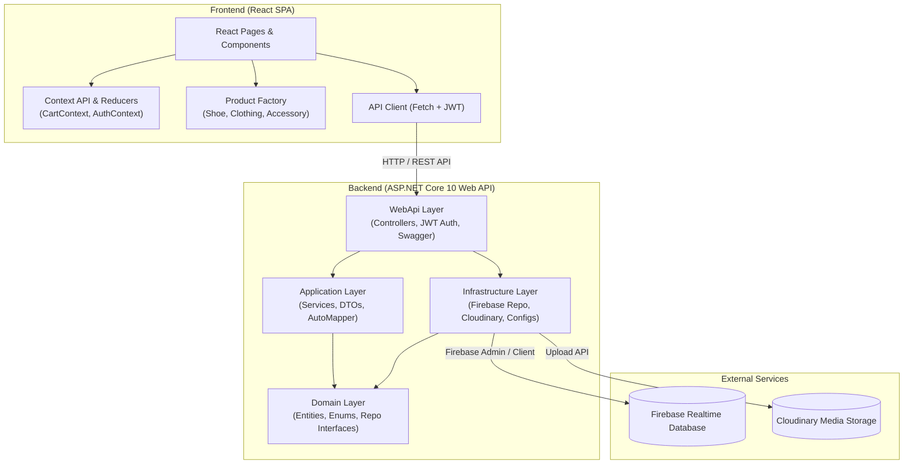

<div align="center">


# New Balance Store

<p>
  <em>
    A full-featured e-commerce web platform for browsing, filtering, and ordering sportswear and footwear online,
    modeled on the official New Balance online store. A university course project built on a modern stack:
    React, ASP.NET Core Web API, and Firebase.
  </em>
</p>

<p>
  <a href="https://balancedevs.onrender.com/"><b>Live Frontend</b></a>
  &nbsp;&bull;&nbsp;
  <a href="https://github.com/AlexElNX/NewBalanceStore"><b>GitHub Repository</b></a>
  &nbsp;&bull;&nbsp;
  <a href="https://newbalancestoreback.onrender.com/swagger"><b>API Documentation (Swagger)</b></a>
  &nbsp;&bull;&nbsp;
  <a href="https://zemnyux.github.io/NewBalanceStoreBack/index.html"><b>Project Documentation (DocFX)</b></a>
</p>

</div>

---

## About

**New Balance Store** is an e-commerce web application designed and built to demonstrate the principles of a scalable Clean Architecture, working with REST APIs, JWT-based authentication, cloud NoSQL databases (Firebase Realtime Database), and developing an interactive user interface in React.

The project reproduces the key user scenarios of a modern branded footwear store: from browsing and multi-criteria filtering of the catalog, to adding product variations (color/size) to the cart, placing an order, and managing the product range.

---

## Features

- **Product catalog with variations**: displays footwear, clothing, and accessories with combinations of sizes and colors, including stock quantity (`quantity`).
- **Flexible search and filtering**:
  - Filtering by category (`Footwear`, `Clothing`, `Accessories`).
  - Filtering by gender (`Men`, `Women`, `Unisex`).
  - Filtering by price range (`minPrice`, `maxPrice`).
  - Selection by color, availability, and the new-arrival flag (`isNew`).
  - Instant text search by model name or description.
- **Interactive product card and product page**:
  - Image gallery with switching of the active color.
  - Dynamic selection of available sizes for the chosen color.
  - Stock indicator and price display (including the previous discounted price, `oldPrice`).
- **Shopping Cart**:
  - Side drawer and an "Added to Bag" popup when a product is added.
  - Quantity changes and item removal.
  - Automatic order total calculation.
  - Cart state synchronization via Context API + Reducer with automatic persistence to `LocalStorage`.
- **Checkout Flow**:
  - Step-by-step validation of the customer's contact details and delivery address.
  - Order saved to the database with the `Pending` status.
- **Authentication and authorization**:
  - User registration and login using JWT tokens.
  - Role-based access model: `Guest`, `Customer`, `Admin`.
  - Protected routes on the frontend.
- **Admin Dashboard**:
  - Full CRUD for products (create, edit, delete).
  - Product image upload directly to Cloudinary via the API.
  - Management and updating of order statuses (`Pending`, `Processing`, `Shipped`, `Delivered`, `Cancelled`).
- **Responsive UI/UX**: support for mobile devices, tablets, and desktops (Mobile-First, from 320px).

---

## Design

The interface design is based on the look of the official [**New Balance**](https://www.newbalance.com/) store:

- **Style**: signature minimalism, clear sans-serif typography, and clean light tones for contrast and a focus on product photography.
- **UI components**:
  - `TopHeader` & `MainHeader`: navigation menu, search bar, authentication links, and a cart icon with an item counter.
  - `ProductFilters`: side filter panel supporting combined selection of criteria.
  - `ProductCard` & `ProductCarousel`: grid and carousels of popular products.
  - `AddedToBagPopup` & `CartDrawer`: smooth modal windows and slide-overs for interacting with the cart without reloading the page.
  - `Footer`: navigation sections, shipping and returns information, and the project's educational status.

---

## Architecture

The project follows the principles of **Clean / Onion Architecture** on the backend, and a modular component architecture with design patterns on the frontend.



### Backend Layers

1. **`NewBalanceStore.Domain`**: the core of the system, independent of any external libraries and databases. Contains business entities (`Product`, `ProductVariant`, `Cart`, `Order`, `User`), enumerations (`ProductType`, `Gender`, `OrderStatus`, `UserRole`), and repository contracts (`IProductRepository`, `IOrderRepository`, `IUserRepository`).
2. **`NewBalanceStore.Application`**: implementation of use cases. Contains product and order services, DTOs, and the AutoMapper mapping profile.
3. **`NewBalanceStore.Infrastructure`**: integration with external cloud services. Contains adapters for Firebase Realtime Database (`FirebaseProductRepository`, `FirebaseOrderRepository`, `FirebaseUserRepository`) and the Cloudinary media service (`PhotoService`).
4. **`NewBalanceStore.WebApi`**: the web server entry point. REST API controllers (`AuthController`, `ProductsController`, `OrdersController`), routing configuration, JWT Bearer authentication setup, CORS policies, and Swagger UI.

### Design Patterns

- **Factory Pattern** (`frontend/src/factory/productFactory.js`): dynamic creation of product objects of the appropriate classes (`Shoe`, `Clothing`, `Accessory`) based on the `type` attribute received from the API.
- **Repository Pattern**: encapsulation of data access behind domain-layer interfaces.
- **Reducer Pattern**: management of the immutable cart state (`cartReducer.js`).
- **Dependency Injection (DI)**: dependency injection via the built-in ASP.NET Core IoC container.

---

## Tech Stack

| Category | Technology | Description |
| :--- | :--- | :--- |
| **Frontend Framework** | React 19 | Library for building the user interface |
| **Build Tool** | Vite 8 | Fast build tool and dev server |
| **Routing** | React Router DOM v7/v8 | Client-side page routing |
| **State Management** | React Context + Reducers | Management of global cart and authentication state |
| **Styles** | CSS / CSS Modules | Modular and global component styles |
| **Backend Framework** | ASP.NET Core Web API (.NET 10) | High-performance server-side REST API framework |
| **Programming Languages** | C# 14 / JavaScript | Backend and frontend languages |
| **Database** | Firebase Realtime Database | Google's cloud real-time NoSQL database |
| **Media Storage** | Cloudinary | Cloud service for optimizing and storing product photos |
| **Authentication** | JWT (JSON Web Tokens) | Authorization using signed tokens and roles |
| **Mapping** | AutoMapper | Automatic conversion of entities to DTOs |
| **API Documentation** | Swagger / OpenAPI + DocFX | Interactive endpoint documentation and a static documentation site |
| **Unit & Integration Testing** | NUnit, Vitest, Testing Library | Testing of the backend and client components |
| **Containerization** | Docker | Containerization of the backend application |

---

## Authentication

Authentication is implemented using the **JSON Web Tokens (JWT)** standard:

1. **Registration / Login**: the client sends a request to `POST /api/auth/register` or `POST /api/auth/login`.
2. **Token issuance**: the backend verifies the credentials and returns a signed token that includes the user's role (`ClaimTypes.Role`) and identifier.
3. **Request authorization**: for protected operations, the token is passed in the header:
   ```http
   Authorization: Bearer <jwt_token>
   ```
4. **Role-Based Access Control (RBAC)**:
   - **Guest**: browsing the catalog and product details, search, filtering, local cart.
   - **Customer**: creating orders.
   - **Admin**: creating/editing/deleting products (`[Authorize(Roles = "Admin")]`) and uploading photos to Cloudinary. The order status update route is currently not protected by authorization.

---

## Product Catalog

The catalog is the key section of the store and supports a detailed domain model:

- **Product entity (`Product`)**:
  - `id`: unique identifier.
  - `name`: commercial model name (for example, *New Balance 9060*, *574 Core*).
  - `description`: description of features, materials, and technologies.
  - `type`: `Footwear`, `Clothing`, `Accessories`.
  - `category`: category (for example, *Running*, *Lifestyle*, *Basketball*).
  - `gender`: `Men`, `Women`, `Unisex`.
  - `price` and `oldPrice`: the current price and the previous price (promotion / discount).
  - `images`: list of high-quality image URLs.
  - `colors`: available color options of the model.
  - `isNew`: new collection flag.
  - `variants`: array of specific stock variations.
- **Product variant (`ProductVariant`)**:
  - `color`: specific color.
  - `size`: size (for example, US 7, 8, 8.5, 9, 10, M, L).
  - `quantity`: number of units in stock.

---

## Configuration

### 1. Backend (`appsettings.json`)

```json
{
  "Firebase": {
    "DatabaseUrl": "https://<your-firebase-database>.europe-west1.firebasedatabase.app/",
    "ProjectId": "<your-project-id>"
  },
  "Jwt": {
    "Secret": "<your-256-bit-secret-key-at-least-32-chars>",
    "Issuer": "NewBalanceStoreBackend",
    "Audience": "NewBalanceStoreFrontend",
    "ExpiryInMinutes": 60
  },
  "CloudinarySettings": {
    "CloudName": "<your-cloudinary-cloud-name>",
    "ApiKey": "<your-cloudinary-api-key>",
    "ApiSecret": "<your-cloudinary-api-secret>"
  }
}
```

### 2. Frontend (`frontend/.env`)

Create a `.env` file in the `frontend/` directory:

```env
VITE_API_URL=http://localhost:5124/api
```

The Firebase URL for the product and order repositories is currently set directly in `NewBalanceStore.WebApi/Program.cs`; the `Firebase:DatabaseUrl` value in the configuration is used by the user repository.

---

## Getting Started

### Prerequisites

- [.NET 10.0 SDK](https://dotnet.microsoft.com/download)
- [Node.js 20.19+ or 22.12+](https://nodejs.org/) & `npm`
- [Git](https://git-scm.com/)

### Running the project locally

1. **Clone the repository**:
   ```bash
   git clone https://github.com/AlexElNX/NewBalanceStore.git
   cd NewBalanceStore
   ```

2. **Run the Backend**:
   ```bash
   # Restore packages and run the API project
   dotnet restore
   dotnet run --project NewBalanceStore.WebApi
   ```
   The API will start at `http://localhost:5124` (or `https://localhost:7124`).
   Swagger UI is available at: `http://localhost:5124/swagger`.

3. **Run the Frontend**:
   ```bash
   cd frontend
   npm install
   npm run dev
   ```
   The client application will open at `http://localhost:5173`.

---

## Build

### Building the backend (Release)

```bash
dotnet build -c Release
dotnet publish NewBalanceStore.WebApi/NewBalanceStore.WebApi.csproj -c Release -o ./publish
```

### Building the frontend

```bash
cd frontend
npm run build
```

The optimized static build files will be created in the `frontend/dist/` directory.

### Generating the documentation site (DocFX)

```bash
docfx docfx.json
```

The generated documentation is stored in the `_site/` folder.

---

## Deployment

- **Backend**: **Render**.
- **Frontend**: see the link to the deployed application at the beginning of this README.
- **Database & Storage**: Google Firebase Realtime Database and Cloudinary are managed in the cloud and accessed via secure API keys.

---

## Testing

The project contains unit and integration tests for selected scenarios:

### 1. Backend tests

- **Unit Tests (`NewBalanceStore.UnitTests`)**: tests for `ProductService`, `OrderService`, `AuthService`, `Cart`, AutoMapper mapping, and controller actions.
- **Integration Tests (`NewBalanceStore.IntegrationTests`)**: `WebApplicationFactory`-based tests for HTTP scenarios covering authentication, products, and orders.

**Run all backend tests:**

```bash
dotnet test
```

### 2. Frontend tests

- Coverage of cart logic (`Cart.test.js`), orders (`Order.test.js`), and interaction on the product page (`ProductPage.test.js`).

**Run the frontend tests:**

```bash
cd frontend
npm run test:run
```

---

## Security

- **Protection against unauthorized access**: `[Authorize(Roles = "Admin")]` attributes are applied to critical data mutation endpoints (creating/editing/deleting products).
- **JWT validation**: strict verification of the token's expiration, secret key signature, issuer (`Issuer`), and audience (`Audience`).
- **Secrets protection**: use .NET User Secrets or environment variables for the JWT secret and Cloudinary credentials; do not commit real secrets to the repository.
- **CORS**: the `AllowReactApp` policy currently allows any origin, header, and method; restrict it before deploying to production.

---

## API

The main REST API routes of the system:

| Method | Endpoint | Access | Description |
| :--- | :--- | :--- | :--- |
| `POST` | `/api/auth/register` | Public | Register a new user |
| `POST` | `/api/auth/login` | Public | Log in and obtain a JWT token |
| `GET` | `/api/products` | Public | Retrieve the product catalog with filtering |
| `GET` | `/api/products/{id}` | Public | Retrieve detailed product information by ID |
| `POST` | `/api/products` | `Admin` | Create a new product |
| `PUT` | `/api/products/{id}` | `Admin` | Update an existing product |
| `DELETE` | `/api/products/{id}` | `Admin` | Delete a product by ID |
| `POST` | `/api/products/upload-image` | `Admin` | Upload a product image to Cloudinary |
| `POST` | `/api/orders` | Public | Place a new order |
| `GET` | `/api/orders/{id}` | Public | Retrieve an order by ID |
| `PATCH` | `/api/orders/{id}/status` | Public | Change the order status (`Shipped`, `Delivered`, etc.) |

*A detailed interactive specification is available in Swagger UI at the `/swagger` route.*

---

## Roadmap

- [x] Implementation of a complete Clean Architecture on the backend.
- [x] Product catalog with filtering and color and size variations.
- [x] Full-featured cart with Context API and LocalStorage persistence.
- [x] Order placement and order status updates.
- [x] JWT authentication and role-based access (Admin/Customer).
- [x] Photo upload via the Cloudinary API.
- [x] Business logic test coverage (NUnit + Vitest).
- [ ] Payment gateway integration (Stripe / LiqPay / MonoPay).
- [ ] Product reviews and ratings from verified buyers.
- [ ] Email notifications to customers about order status changes.

---

## Authors

Development team **BalanceDevs**:

- [@AlexElNX](https://github.com/AlexElNX) — *Team Lead and Frontend Developer*
- [@ZemNyux](https://github.com/ZemNyux) — *Backend Developer*
- [@kasatjk](https://github.com/kasatjk) — *Tester and Technical Writer*
- [@AlexDrts](https://github.com/AlexDrts) — *Full-Stack Developer*
