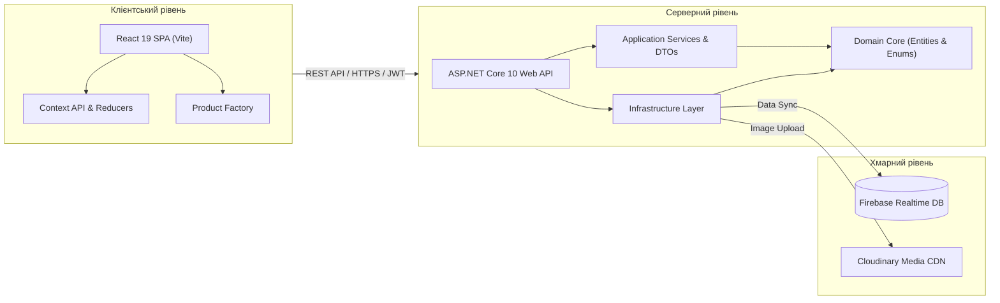

# Вступ до системи New Balance Store

> **Технічна документація платформи електронної комерції**  
> Версія: 1.2 | Статус: Approved | Стек: React 19 + ASP.NET Core 10 Web API + Firebase RTDB

---

## 1. Призначення та цілі системи

**New Balance Store** — це модульна вебплатформа електронної комерції (e-commerce), призначена для демонстрації сучасних інженерних практик побудови повнофункціональних розподілених застосунків. Платформа моделює повний життєвий цикл онлайн-продажів спортивного взуття, одягу та аксесуарів: від інтерактивного каталогу з багаторівневою фільтрацією та складським обліком варіацій до оформлення замовлення, обробки медіафайлів та панелі адміністрування.

### Ключові інженерні цілі:
- **Clean / Onion Architecture**: сувора ізоляція ядра доменної логіки від деталей реалізації інфраструктури, протоколів передачі даних та сторонніх бібліотек.
- **RESTful API Design**: стандартизований інтерфейс взаємодії між клієнтом і сервером з чіткими HTTP-дієсловами, статус-кодами відповідей та документацією OpenAPI (Swagger).
- **Type Safety & Contracts**: використання DTO (Data Transfer Objects), суворої типізації моделей у C# та патерну Factory для доменної типізації на клієнті.
- **Безпека та контроль доступу**: аутентифікація на основі безстанних JSON Web Tokens (JWT) із рольовим розмежуванням доступу (RBAC).
- **Висока якість коду**: повне покриття модульних та інтеграційних тестів (NUnit, Vitest) із перевіркою контрактів та бізнес-правил.

---

## 2. Предметна область (Domain Scope)

Система реалізує модель електронного каталогу роздрібної мережі з наступними сутностями та бізнес-правилами:

1. **Товарні позиції (Product)**:
   - Базова модель виробу має атрибути: назва, опис, категорія, цільова активність, гендерна приналежність, ціна, стара ціна (акція), ознака новинки (`isNew`).
   - Номенклатура ділиться на три основні типи: **Footwear** (взуття), **Clothing** (одяг), **Accessories** (аксесуари).
2. **Складські варіації (ProductVariant)**:
   - Кожен товар має набір варіацій, що визначаються парою `Color + Size`.
   - Для кожної варіації ведеться облік залишку одиниць на складі (`quantity`).
   - Клієнтська частина унеможливлює додавання до кошика позицій, залишок яких дорівнює нулю.
3. **Кошик покупця (Cart & CartItem)**:
   - Інкапсулює вибрані позиції з прив'язкою до ідентифікатора користувача або локальної сесії.
   - Забезпечує незмінність стану та синхронізацію через React Context API та Reducer.
4. **Замовлення (Order & OrderItem)**:
   - Фіксує стан покупки на момент підтвердження замовлення.
   - Вартість кожної позиції перевіряється та фіксується за серверним каталогом на момент створення замовлення для запобігання фальсифікації цін клієнтом.
   - Життєвий цикл статусу: `Pending` -> `Processing` -> `Shipped` -> `Delivered` (або `Cancelled`).

---

## 3. Загальна архітектура системи

Система складається з трьох ключових рівнів:

---

## 4. Рольова модель та матриця доступу

Система реалізує трьохрівневу модель управління доступом (RBAC):

| Дія / Маршрут | Гість (Guest) | Покупець (Customer) | Адміністратор (Admin) |
| :--- | :---: | :---: | :---: |
| Перегляд каталогу товарів | ✅ | ✅ | ✅ |
| Фільтрація та текстовий пошук | ✅ | ✅ | ✅ |
| Перегляд сторінки товару та варіацій | ✅ | ✅ | ✅ |
| Додавання товару до кошика | ✅ | ✅ | ✅ |
| Оформлення замовлення (Checkout) | ✅ | ✅ | ✅ |
| Реєстрація та вхід у систему | ✅ | ✅ | ✅ |
| Створення нових товарів у каталозі | ❌ | ❌ | ✅ (`[Authorize(Roles="Admin")]`) |
| Оновлення існуючих товарів | ❌ | ❌ | ✅ (`[Authorize(Roles="Admin")]`) |
| Видалення товарів із каталогу | ❌ | ❌ | ✅ (`[Authorize(Roles="Admin")]`) |
| Завантаження зображень до Cloudinary | ❌ | ❌ | ✅ (`[Authorize(Roles="Admin")]`) |
| Оновлення статусів замовлень | ❌ | ❌ | ✅ (`[Authorize(Roles="Admin")]`) |

---

## 5. Стандарти кодування та документації

- **Документаційні коментарі**: усі публічні інтерфейси, класи, методи та властивості у проєкті супроводжуються докладними XML-коментарями у C# та JSDoc-коментарями у JavaScript.
- **Чистота коду (Clean Code)**: дотримання принципів SOLID, єдиної відповідальності класів, відсутність дублювання логіки та явне впровадження залежностей (Dependency Injection).
- **Безпека**: паролі зберігаються виключно у вигляді криптографічних солених хешів PBKDF2 (`PasswordHasher<User>`). Автентифікаційні токени перевіряються за підписом HMAC-SHA256, часом життя (`Lifetime`), видавцем (`Issuer`) та споживачем (`Audience`).
# Introduction